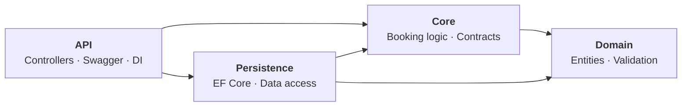

<div align="center">

# Room Booking API

### A test-driven ASP.NET Core Web API where every behavior started as a failing test.

<br/>


<br/>

[](#overview)
[](#architecture)
[](#tdd-in-action)
[](#test-suite)
[](#api-reference)
[](#getting-started)

</div>

<br/>

<div align="center">

| 4 | 3 | 13 | .NET 9 |
|:---:|:---:|:---:|:---:|
| **Clean layers** | **Test projects** | **Test cases** | **Target framework** |

</div>

---

## Overview

Room Booking API lets a client book a conference room for a given date. It checks which rooms are free, books the first available one, and returns a clear success or failure result.

I built it to apply what I learned in **Test Driven Development (TDD) in .NET** by Trevoir Williams, and to practice one idea:

> AI can generate code in seconds, but a developer still has to prove it is correct.

Here, the tests define the requirements first, and the code exists to satisfy them.

**What this project demonstrates**

- The Red, Green, Refactor cycle applied to real business rules
- Business logic isolated from the database and the web layer
- Unit tests, controller tests, and EF Core data-access tests in separate projects
- Dependency inversion: the core defines the contracts, the outer layers implement them
- Input validation built into the domain model

---

## Architecture

Four layers, three test projects. Dependencies point inward, so the business logic never depends on EF Core or ASP.NET.



| Layer | Responsibility | Tested by |
|---|---|---|
| `RoomBookingApp.API` | Endpoints, request validation, Swagger, dependency injection | `RoomBookingApp.API.Tests` |
| `RoomBookingApp.Core` | `RoomBookingRequestProcessor` (booking rules) and `IRoomBookingService` | `RoomBookingApp.Core.Test` |
| `RoomBookingApp.Persistence` | `RoomBookingService` and `RoomBookingAppDbContext` | `RoomBookingApp.Persistence.Test` |
| `RoomBookingApp.Domain` | `Room`, `RoomBooking`, shared base model with validation | Covered through the layers above |

**How a booking works**

1. The client sends `POST /api/RoomBooking` with a name, email, and date.
2. The controller validates the model: required fields, valid email, and a date in the future.
3. The processor asks `IRoomBookingService` for the rooms available on that date.
4. If a room is free, the booking is saved against the first available room and the result is `Success` with a booking ID.
5. If no room is free, the API returns `400 Bad Request` with `No Rooms Available For Given Date`.

---

## TDD in Action

Each rule began as a failing test, got the smallest implementation to pass, and was then refactored.

| Requirement, written as a test first | Test |
|---|---|
| The result mirrors the request values | `Should_Return_RoomBooking_Response_With_Request_Values` |
| A null request throws a clear `ArgumentNullException` | `Should_Throw_ArgumentNullException_When_Request_Is_Null` |
| A booking is saved with the correct room | `Should_Save_RoomBooking_Request` |
| Nothing is saved when no room is free | `Should_Not_Save_RoomBooking_Request_If_Room_Is_Unavailable` |
| The result flag reflects success or failure | `Should_Return_SuccessOrFailure_Flag_In_Result` |
| A booking ID is returned only on success | `Should_Return_BookingId_In_Result` |
| The controller returns `200` or `400` and calls the processor only when valid | `Should_Call_Booking_Method_When_Valid` |
| Only unbooked rooms are returned for a date | `Should_Return_Available_Rooms` |
| A booking is persisted correctly | `Should_Save_Room_Booking` |

The style: Moq isolates the unit, Shouldly keeps assertions readable.

```csharp
[Fact]
public void Should_Not_Save_RoomBooking_Request_If_Room_Is_Unavailable()
{
    _availableRooms.Clear(); // simulate a fully booked day

    _processor.BookRoom(_request);

    _roomBookingServiceMock.Verify(x => x.Save(It.IsAny<RoomBooking>()), Times.Never);
}
```

---

## Test Suite

**10 test methods and 13 test cases across 3 projects.**

| Project | Type | Techniques |
|---|---|---|
| `RoomBookingApp.Core.Test` | Unit tests | `[Fact]` and `[Theory]`, Moq mocks with callbacks and `Verify`, Shouldly |
| `RoomBookingApp.API.Tests` | Controller tests | `[Theory]` with `[InlineData]` for valid and invalid model states, checking the result type and call count |
| `RoomBookingApp.Persistence.Test` | Data-access tests | EF Core InMemory provider to test real queries and saves without a database server |

**Approach**

- **Unit tests** mock the data service, so the booking rules are tested with no database involved.
- **Theories** cover several scenarios (success and failure, valid and invalid) with one test body.
- **Data-access tests** run real EF Core queries, because mocks cannot catch query or mapping mistakes.

```bash
dotnet test RoomBookingApp.slnx
```

---

## API Reference

### `POST /api/RoomBooking`

**Request**

```json
{
  "fullName": "Jane Doe",
  "email": "jane.doe@example.com",
  "date": "2026-12-01T00:00:00"
}
```

**Success: `200 OK`** (`flag: 0` means `Success`)

```json
{
  "flag": 0,
  "roomBookingId": 1,
  "fullName": "Jane Doe",
  "email": "jane.doe@example.com",
  "date": "2026-12-01T00:00:00"
}
```

**No room available: `400 Bad Request`**

```json
{
  "Date": ["No Rooms Available For Given Date"]
}
```

**Validation rules**

| Field | Rule |
|---|---|
| `fullName` | Required, up to 80 characters |
| `email` | Required, valid email format, up to 80 characters |
| `date` | Must be in the future |

The app seeds three rooms (Conference Room A, B, and C), so the **fourth** booking for the same date returns `400`.

---

## Getting Started

**Prerequisite:** [.NET 9 SDK](https://dotnet.microsoft.com/download)

```bash
# 1. Clone the repository
git clone https://github.com/belsaied/RoomBookingApp_TDD.git
cd RoomBookingApp_TDD

# 2. Run the tests
dotnet test RoomBookingApp.slnx

# 3. Start the API
dotnet run --project RoomBookingApp.API
```

Then open **http://localhost:5103/swagger** and try the `POST /api/RoomBooking` endpoint.

> The API uses an in-memory SQLite database, so data resets on every restart. This keeps the project runnable with zero setup.

---

## Tech Stack

| Area | Tools |
|---|---|
| Framework | .NET 9, ASP.NET Core Web API |
| Data | Entity Framework Core 9, SQLite (runtime), EF Core InMemory (tests) |
| Testing | xUnit, Moq, Shouldly |
| Docs | Swagger / Swashbuckle |

---

## Project Structure

```
RoomBookingApp_TDD
├── RoomBookingApp.API                # Controllers, Program.cs, Swagger
├── RoomBookingApp.API.Tests          # Controller tests
├── RoomBookingApp.Core               # Business logic and service contracts
│   ├── DataServices
│   ├── Enums
│   ├── Models
│   └── Processors
├── RoomBookingApp.Core.Test          # Unit tests for the booking logic
├── RoomBookingApp.Domain             # Entities and validation base model
├── RoomBookingApp.Persistence        # EF Core context and data service
├── RoomBookingApp.Persistence.Test   # Data-access tests
└── RoomBookingApp.slnx
```

---

## Roadmap

- [x] GitHub Actions pipeline that runs the tests on every push and pull request
- [x] Branch protection so failing tests block merges
- [x] End-to-end API tests with `WebApplicationFactory`
- [x] Async data access
- [x] Persistent database (SQL Server) with migrations
- [x] Code coverage report

---

<div align="center">

### Built by [belsaied](https://github.com/belsaied)

Moving from software engineer to product engineer: owning a feature from requirement to tested, reliable delivery.

Course: *Test Driven Development (TDD) in .NET* by Trevoir Williams on Udemy

[](https://www.linkedin.com/in/your-profile)
[](https://github.com/belsaied/RoomBookingApp_TDD)

</div>
